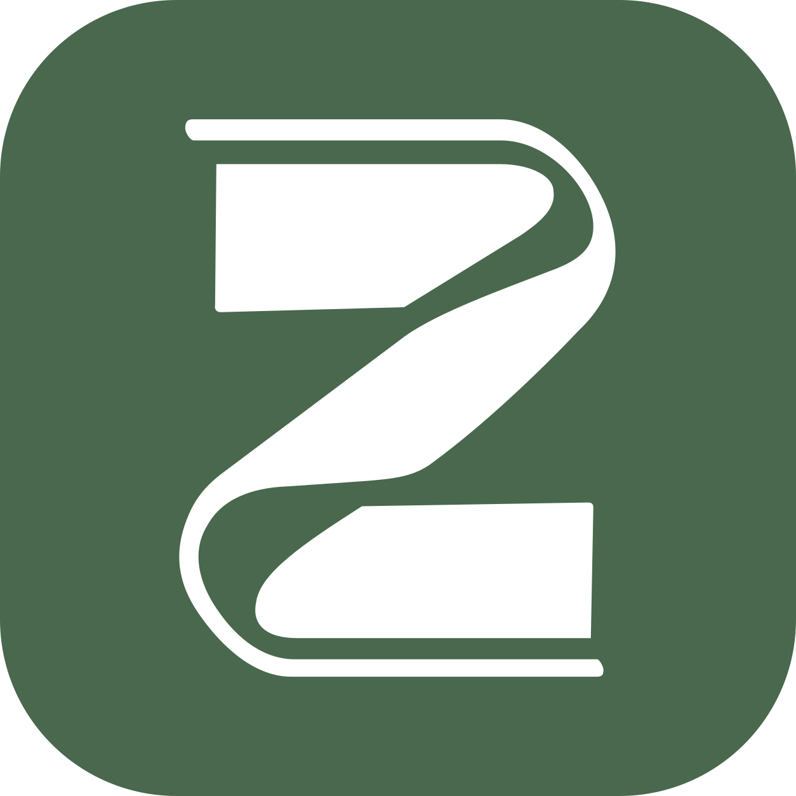

<div align="center">



# ZViewer

[简体中文](README.md) | [**English**](README.en.md)

[](https://github.com/Zo-Live/ZViewer/releases/latest) [](LICENSE) [](#install-and-start-reading) [](https://kotlinlang.org) [](https://developer.android.com/compose)

**A native Android local comic reader with support for common archive formats, PDF, image folders, and video folders.**

</div>

## Install and Start Reading

Supports Android 10 and later; the universal APK works on mainstream phones and emulators.

On first launch, tap "Select library folder", navigate to your comic directory in the system file picker, tap "Use this folder", and grant access. The app scans the directory and remembers the permission, so later launches open directly to the library.

Android usually does not allow granting access to the internal storage root, the Download root, or Android/data. Create a specific comic subfolder, such as `Download/comics`, and select that. The app does not need the "All files access" permission.

## Features

| Category        | Support                                                                                                  |
| --------------- | -------------------------------------------------------------------------------------------------------- |
| Comic sources   | ZIP / CBZ, RAR / CBR, 7Z, PDF, image folders, video folders                                              |
| Static images   | JPG, JPEG, PNG, WebP, BMP, HEIF, HEIC, AVIF                                                              |
| Animated images | APNG, Animated WebP, GIF, Animated AVIF                                                                  |
| Video           | MP4, M4V, MKV, WebM, AVI, MOV, 3GP, MPG, MPEG, TS, MTS, M2TS, FLV, WMV, OGV, and more                    |
| Library         | Recursive scan, natural sorting, search, reading-status filter, recently read, favorites                 |
| Reading         | Continuous vertical / horizontal / right-to-left paging, mixed images and videos, looping, auto-saved progress |

- Long-press any comic cover to manage favorites in bulk.
- If something goes wrong, enable "Diagnostic log" in Settings and pick a log folder, then share the log file with the developer after reproducing the issue.

## Format Support and Limitations

- Files are sorted naturally by file name, so `2.jpg` comes before `10.jpg`.
- Images or videos directly contained in a folder form one book; each subdirectory is scanned separately. Mixed image/video content is combined into one book in natural order.
- Video codec support depends on the device's Media3 / system decoders; HEIF / HEIC display also depends on the device, and animated HEIF is not supported.
- PDFs are supported only at the library root or in uncompressed subdirectories; PDFs inside archives must be extracted first.
- 7Z solid archives need their whole content prepared on first open, so larger books take longer to open.
- Encrypted archives, multi-volume files, password-protected PDFs, and DRM content are not supported yet; decrypt or extract them to a folder first.

## Privacy and Data

ZViewer does not request network permission and contains no accounts or ads. Reading history, covers, and caches are stored locally on the device.

- Archives are fully extracted on first read, and the extracted content counts toward the reading cache.
- When the reading cache reaches about **1.5 GiB**, background cleanup removes the least recently used entries down to about **1 GiB**. Cleanup only removes regenerable caches and never touches originals, reading history, or favorites.

## Local Build

Requires JDK 17 and Android SDK 36; the project ships with a Gradle wrapper.

```sh
export JAVA_HOME=/usr/lib/jvm/java-17-openjdk-amd64
export ANDROID_HOME="$HOME/Android"
./gradlew :app:assembleDebug :app:testDebugUnitTest :app:lintDebug
```

You can also set `sdk.dir` in an untracked `local.properties`.

## Release Build and Signing

The key is located at `.signing/zviewer-release.jks` with alias `zviewer`; passwords are passed via `ZVIEWER_STORE_PASSWORD` and `ZVIEWER_KEY_PASSWORD`.

```sh
./gradlew :app:assembleRelease
```

The artifact is written to `app/build/outputs/apk/release/`; official release APKs and their SHA-256 checksums go in `dist/`.

The private key and passwords must not be committed to Git, and `.signing/` must be backed up separately and securely. Later releases must use the same key and an incremented `versionCode`, or installed apps cannot be upgraded in place.

## Testing and Implementation Docs

- [Development plan](docs/开发计划.md) · [Architecture and compatibility](docs/架构与兼容性.md) · [Test log](docs/测试记录.md)
- Core logic tests are in `app/src/test/`, device format integration tests are in `app/src/androidTest/`, and fixtures are generated by `tools/generate_fixtures.py`.

## Open Source Components

Built on open source components including [AndroidX / Compose](https://github.com/androidx/androidx), [Media3](https://github.com/androidx/media), the [Android Open Source Project](https://android.googlesource.com/platform/frameworks/base/), [Kotlin](https://github.com/JetBrains/kotlin), [libarchive](https://github.com/libarchive/libarchive), [APNG4Android](https://github.com/penfeizhou/APNG4Android), and [libavif](https://github.com/AOMediaCodec/libavif).

## License

MIT
