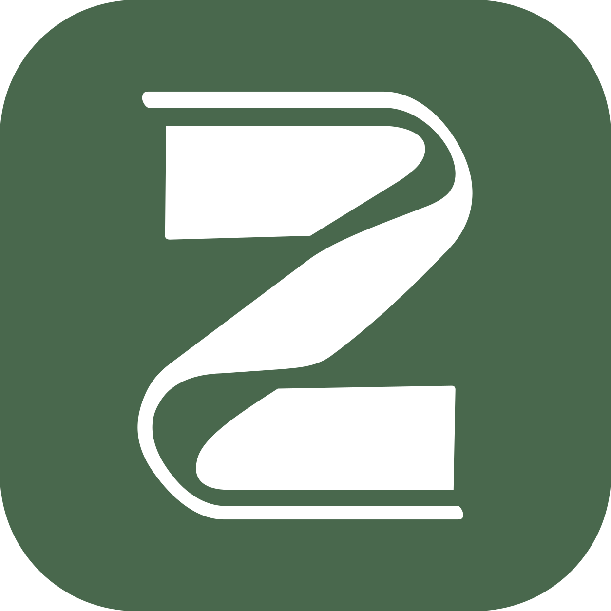

<div align="center">



# ZViewer

[**简体中文**](README.md) | [English](README.en.md)

[](https://github.com/Zo-Live/ZViewer/releases/latest) [](LICENSE) [](#安装与开始阅读) [](https://kotlinlang.org) [](https://developer.android.com/compose)

**一个原生 Android 本地漫画阅读器，支持常见压缩格式、PDF、图片与视频文件夹。**

</div>

## 安装与开始阅读

支持 Android 10 及以上，通用安装包适用于主流手机与模拟器。

首次打开时点击「选择书库文件夹」，在系统文件选择器中进入漫画目录，点击「使用此文件夹」并授权。应用会扫描该目录并记住授权，之后启动直接显示书库。

Android 通常不允许授权内部存储根目录、Download 根目录及 Android/data。请创建一个具体的漫画子文件夹，例如 `Download/comics`，再选择它。应用无需「所有文件访问」权限。

## 功能

| 类别     | 支持                                                                           |
| -------- | ------------------------------------------------------------------------------ |
| 漫画来源 | ZIP / CBZ、RAR / CBR、7Z、PDF、图片文件夹、视频文件夹                          |
| 静态图片 | JPG、JPEG、PNG、WebP、BMP、HEIF、HEIC、AVIF                                    |
| 动态图片 | APNG、Animated WebP、GIF、Animated AVIF                                        |
| 视频     | MP4、M4V、MKV、WebM、AVI、MOV、3GP、MPG、MPEG、TS、MTS、M2TS、FLV、WMV、OGV 等 |
| 书库     | 递归扫描、自然排序、搜索、阅读状态筛选、最近阅读、收藏                         |
| 阅读     | 垂直连续 / 水平翻页 / 从右向左翻页、图片视频混合、首尾循环、进度自动保存       |

- 长按任意漫画封面进入收藏管理，可批量收藏 / 取消收藏。
- 如遇问题，可在设置中开启「输出诊断日志」并选择日志目录，复现后把日志文件反馈给开发者。

## 格式支持与限制

- 文件按文件名自然排序，例如 `2.jpg` 排在 `10.jpg` 前。
- 文件夹中直接包含的图片或视频组成一本书，子目录分别扫描；图片与视频混合时按自然排序放在同一本书中。
- 视频编码兼容性取决于设备 Media3 / 系统解码器；HEIF / HEIC 能否显示同样取决于设备，且不支持动态 HEIF。
- PDF 只支持书库根目录或未压缩的子目录；压缩包内的 PDF 需先解压后阅读。
- 7Z 固实压缩包首次打开需要先准备整本内容，较大的书会等待较久。
- 加密压缩包、分卷文件、密码 PDF 和 DRM 内容暂不支持，请先解密或解压为文件夹。

## 隐私与数据

ZViewer 不申请联网权限，不包含账号或广告。阅读记录、封面与缓存都保存在设备本地。

- 压缩包首次阅读时会完整解压其中的图片和视频，解压内容计入阅读缓存。
- 阅读缓存合计达到约 **1.5 GiB** 时会在后台按最近使用顺序回收至约 **1 GiB**；清理只删除可重新生成的缓存，不影响漫画原件、阅读记录和收藏。

## 本地构建

需要 JDK 17 与 Android SDK 36，工程自带 Gradle Wrapper。

```sh
export JAVA_HOME=/usr/lib/jvm/java-17-openjdk-amd64
export ANDROID_HOME="$HOME/Android"
./gradlew :app:assembleDebug :app:testDebugUnitTest :app:lintDebug
```

也可在未跟踪的 `local.properties` 中设置 `sdk.dir`。

## 发布构建与签名

密钥位于 `.signing/zviewer-release.jks`，别名为 `zviewer`；口令通过 `ZVIEWER_STORE_PASSWORD`、`ZVIEWER_KEY_PASSWORD` 传入。

```sh
./gradlew :app:assembleRelease
```

产物位于 `app/build/outputs/apk/release/`，正式发布包及其 SHA-256 校验文件放在 `dist/`。

私钥与口令不得提交到 Git，`.signing/` 须单独安全备份。后续发布必须使用同一密钥并递增 `versionCode`，否则已安装的应用无法覆盖升级。

## 测试与实现文档

- [开发计划](docs/开发计划.md) · [架构与兼容性](docs/架构与兼容性.md) · [测试记录](docs/测试记录.md)
- 核心逻辑测试在 `app/src/test/`，设备格式集成测试在 `app/src/androidTest/`，样本由 `tools/generate_fixtures.py` 生成。

## 开源组件

基于 [AndroidX / Compose](https://github.com/androidx/androidx)、[Media3](https://github.com/androidx/media)、[Android 开源项目](https://android.googlesource.com/platform/frameworks/base/)、[Kotlin](https://github.com/JetBrains/kotlin)、[libarchive](https://github.com/libarchive/libarchive)、[APNG4Android](https://github.com/penfeizhou/APNG4Android) 与 [libavif](https://github.com/AOMediaCodec/libavif) 等开源组件构建。

## 许可证

MIT
